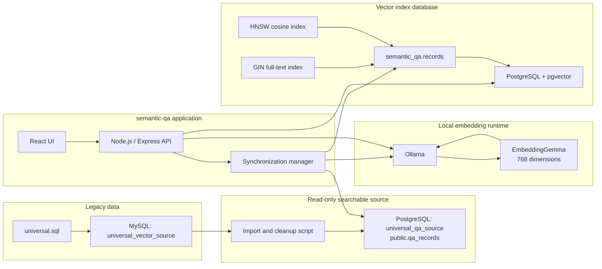
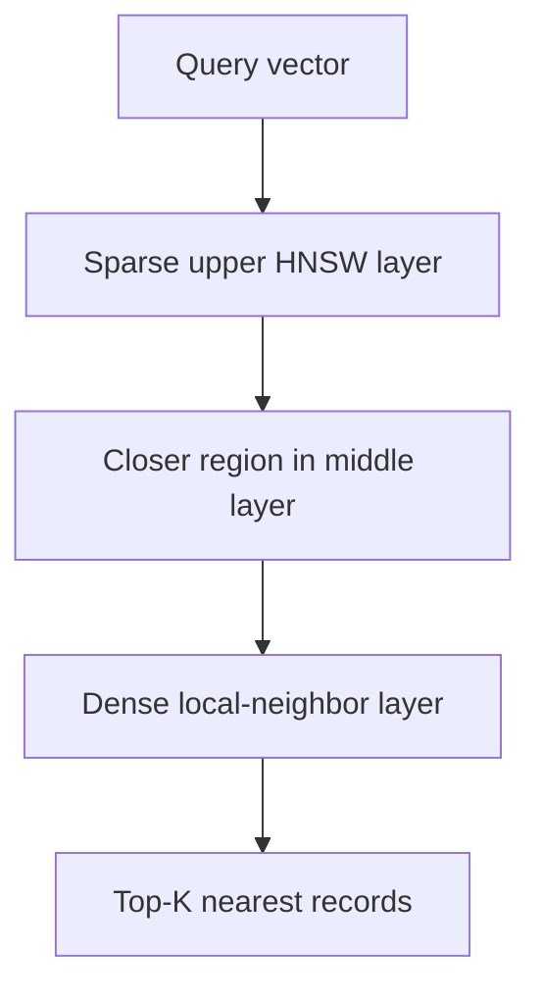
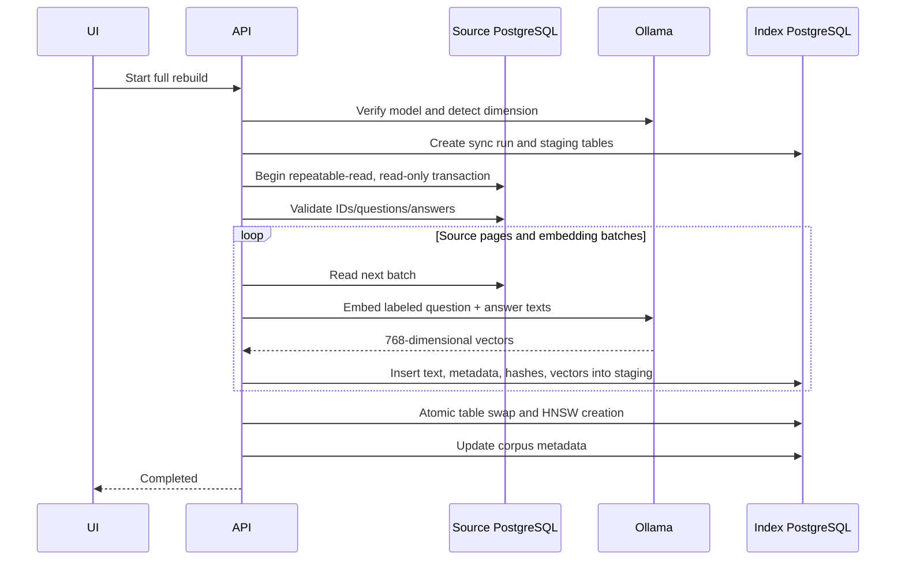
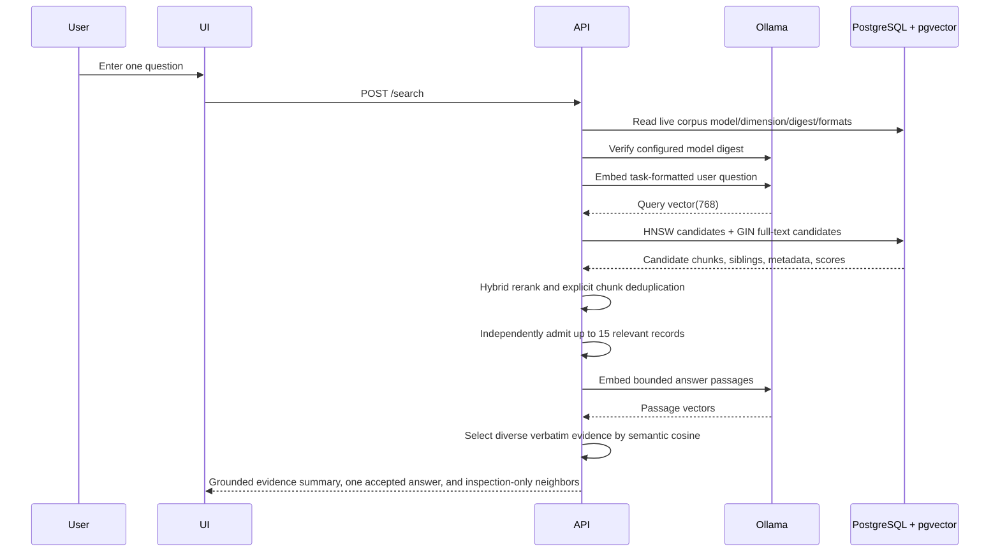

# Semantic Q&A: Technical Architecture and Internal Working

This guide explains the `semantic-qa` tool for developers who are new to PostgreSQL, pgvector, Ollama, embeddings, and semantic search. It describes the implementation that is running in this workspace, including the imported `tblQA` and `tblDiscourse` corpus.

## 1. The Short Version

The tool does not write an answer with AI. It retrieves answer text that already exists in the database.

It works in two phases:

1. **Offline indexing:** source text is cleaned, split into safe chunks, converted into numeric vectors by EmbeddingGemma through Ollama, and stored in PostgreSQL with pgvector.
2. **Online search:** the new user question is converted into another vector, PostgreSQL combines semantic and full-text candidates, deterministic code reranks them, and the tool returns their stored text unchanged.

The most important distinction is:

> The corpus is indexed, not used to train the model.

EmbeddingGemma is already trained. This application does not fine-tune it, update its weights, or teach it facts from this database.

## 2. Current Deployment

| Component | Current value |
| --- | --- |
| Web application | React UI with a Node.js/Express API |
| Standalone UI/API | `http://localhost:8790` |
| Ollama | `http://127.0.0.1:11434` |
| Embedding model | `embeddinggemma` |
| Model context limit | 2,048 tokens in the current Ollama installation |
| Vector dimension | 768 floating-point values |
| Source PostgreSQL | `127.0.0.1:5433/universal_qa_source` |
| Index PostgreSQL | `127.0.0.1:5433/universal_qa_index` |
| Vector extension | pgvector 0.8.5 |
| Live vector records after the retrieval-v2 rebuild | 19,777 |
| Original active records | 419 Q&As and 5,591 discourses |
| Languages in the imported corpus | English, Malayalam, and Telugu |
| Universal-corpus match threshold | 0.49 |

The current local `ollama show embeddinggemma` output reports a 307.58-million-parameter Gemma architecture, BF16 quantization, a 2,048-token context, and 768-dimensional embeddings. These details belong to the installed model tag and could change if that tag is replaced later.

## 3. System Architecture



### Why are there two PostgreSQL databases?

The source database and index database have different responsibilities:

- `universal_qa_source` is the normalized, readable corpus. The application uses a read-only account for synchronization.
- `universal_qa_index` is owned by the tool. It stores exact synchronized text snapshots, metadata, embeddings, synchronization history, staging tables, and the HNSW index.

This separation prevents the retrieval tool from writing into the source corpus and allows a failed rebuild to leave the existing live index intact.

## 4. Data Preparation from MySQL

The legacy dump is first imported into MySQL as `universal_vector_source`. The application does not search MySQL directly. The importer at `scripts/importUniversalQa.js` produces a stable PostgreSQL projection.

### `tblQA` mapping

| MySQL field | Search meaning |
| --- | --- |
| `qaId` | Original source identity |
| `title` | Stored question |
| `answerBySwami` | Stored answer |
| `briefQuestion` or `questionBk` | Additional source context used by hybrid reranking |
| `masterLanguage` | Language metadata |
| `masterId`, `recordDate` | Source metadata |

### `tblDiscourse` mapping

| MySQL field | Search meaning |
| --- | --- |
| `dcId` | Original source identity |
| `title` | Stored question/title |
| `textDC` | Stored answer/document text |
| `summary` | Additional source context used by hybrid reranking |
| `masterLanguage` | Language metadata |
| `masterId`, `recordDate` | Source metadata |

`tblDiscourse` does not consistently contain one explicit database row per question and answer. The importer therefore does not invent Q&A boundaries. It treats the title as the question/title and divides the existing discourse text into ordered answer chunks.

### Cleanup

The importer:

- includes active records only;
- requires a non-empty title/question and answer/document body;
- removes legacy HTML tags;
- decodes named and numeric HTML entities;
- normalizes layout whitespace;
- preserves Unicode text;
- does not summarize, translate, or generate new prose.

“Verbatim answer” in the search application means verbatim from this normalized PostgreSQL source projection. The raw MySQL HTML is deliberately converted to readable plain text before it becomes the searchable source.

### Chunking

Embedding models have a finite context window. The current model accepts at most 2,048 tokens, and the API explicitly sends `truncate: false`. Oversized text therefore causes a visible synchronization failure instead of silent data loss.

The importer uses conservative character limits:

| Record type | Language | Maximum answer characters per chunk |
| --- | --- | ---: |
| `tblQA` | All | 1,800 |
| `tblDiscourse` | English | 3,600 |
| `tblDiscourse` | Malayalam or Telugu | 1,400 |

These are character limits, not token limits. Malayalam and Telugu use smaller limits because their tokenizer-to-character ratio can be higher than English.

The chunker prefers paragraph boundaries. If one paragraph is still too large, it cuts at a nearby whitespace boundary. Adjacent chunks repeat a bounded contiguous source passage—300 characters for English discourses and 140 for Malayalam/Telugu—so an answer crossing a boundary remains retrievable. The repeated text is copied verbatim rather than generated. Every chunk contains:

- a stable `source_id` such as `qa:52:001` or `discourse:533:005`;
- a `source_group` pointing to the original Q&A or discourse;
- `chunk_index` and `chunk_count`;
- the original record ID and source type;
- language and source metadata.

Current output:

| Source | Original active records | Search chunks |
| --- | ---: | ---: |
| `tblQA` | 419 | 956 |
| `tblDiscourse` | 5,591 | 18,821 |
| **Total** | **6,010** | **19,777** |

## 5. What Ollama Does

Ollama is the local process that loads and runs the embedding model. The Node.js application sends HTTP requests to:

```text
POST http://127.0.0.1:11434/api/embed
```

The request is conceptually:

```json
{
  "model": "embeddinggemma",
  "input": ["text one", "text two"],
  "truncate": false
}
```

Ollama returns one numeric array for every input string.

Ollama is not a database and does not remember the corpus. It only performs model inference:

```text
text -> embedding model -> vector
```

The vectors are stored by PostgreSQL, not by Ollama.

The application restricts Ollama URLs to loopback hosts (`127.0.0.1`, `localhost`, or `::1`). This avoids accidentally sending corpus text to a remote embedding service.

## 6. What an Embedding Is

An embedding is a numeric representation of meaning. For the installed model, every text becomes an array of 768 numbers:

```text
[0.018, -0.042, 0.007, ... 765 more values]
```

The individual numbers do not have human-readable labels. Their usefulness comes from geometry:

- texts with related meaning tend to point in similar directions;
- unrelated texts tend to point in different directions;
- the same vector size is produced for a short question and a long chunk.

During indexing with EmbeddingGemma, the tool embeds this exact structure:

```text
title: <stored question or title> | text: <stored answer chunk>

Source context:
<optional detailed question or summary>
```

During search, it embeds:

```text
task: question answering | query: <new user question>
```

The index stores embedding- and retrieval-format versions alongside the model and dimension. Search is rejected with a full-rebuild instruction when either stored format is older than the running application. An incremental sync is also rejected when the format changes, so vectors created from different document inputs can never be mixed.

### The same model must be used on both sides

Vectors made by different models do not share a reliable coordinate system. Even two models that both return 768 numbers can assign different meanings to those coordinates.

For that reason, the index stores:

- embedding model name;
- immutable model digest reported by Ollama;
- embedding dimension;
- Ollama URL used for the corpus.

If the model tag resolves to different weights—even with the same name and dimension—or if the dimension or embedding format changes, the tool requires a full rebuild before search is allowed.

## 7. Training vs. Indexing

These terms are often confused.

### Model training

Training changes the neural network’s internal weights. It normally needs a training dataset, loss function, optimizer, significant compute, and an evaluation process.

This application performs **no training and no fine-tuning**.

### Embedding inference

Inference runs the already-trained model. It converts each text into a vector but does not modify the model.

This is what Ollama does here.

### Vector indexing

Indexing stores the vectors and builds a data structure that makes nearest-neighbor lookup fast.

This is what PostgreSQL and pgvector do here.

Adding records to the vector database does not teach EmbeddingGemma new facts. The facts remain in PostgreSQL text fields; the vector is only a retrieval key pointing toward that stored text.

## 8. PostgreSQL and pgvector Storage

The index database owns a `semantic_qa` schema.

### `semantic_qa.corpus`

One row describes the live corpus:

- source field mapping;
- embedding model;
- embedding dimension;
- Ollama URL;
- live record count;
- last synchronization time.

### `semantic_qa.records`

Each searchable chunk stores:

| Column | Purpose |
| --- | --- |
| `source_id` | Stable unique source/chunk ID |
| `question` | Exact synchronized question/title |
| `answer` | Exact synchronized normalized answer chunk |
| `metadata` | JSON source type, IDs, language, date, and chunk information |
| `source_group` | Original Q&A/discourse group |
| `source_order` | Chunk ordering value |
| `content_hash` | SHA-256 change detector |
| `embedding` | `vector(768)` semantic representation |
| `updated_at` | Index update time |

The 768 raw float values alone require roughly 3 KiB per record if represented as 32-bit values. For 19,777 vectors, that is about 58 MiB before PostgreSQL row, text, metadata, GIN, and HNSW overhead. Actual database size is larger because exact answer text is also stored.

### `semantic_qa.sync_runs`

This table preserves recent synchronization outcomes and counters. Live SSE job listeners are held in Node.js memory, so a server restart ends live progress streaming but does not remove persisted completed-run history.

### Staging tables

Each synchronization run creates tool-owned unlogged tables:

- a staging records table for changed vectors;
- a “seen IDs” table containing the complete current source identity set.

They are temporary working structures used to protect the live index.

## 9. Cosine Similarity

Cosine similarity measures the angle between two vectors rather than their absolute length.

For vectors `A` and `B`:

```text
cosine_similarity(A, B) = dot(A, B) / (length(A) * length(B))
```

Interpretation:

- `1.0`: same direction;
- `0.0`: geometrically unrelated/orthogonal;
- `-1.0`: opposite direction.

Real embedding scores are model- and corpus-dependent. A score is not a probability and `0.70` does not mean “70% correct.”

pgvector’s `<=>` operator returns **cosine distance**:

```text
cosine_distance = 1 - cosine_similarity
```

The search SQL therefore calculates similarity as:

```sql
1 - (embedding <=> $query_vector) AS similarity
```

and sorts nearest first:

```sql
ORDER BY embedding <=> $query_vector
LIMIT $top_k
```

The universal corpus uses a clear-match threshold of `0.49`. The smaller sample/default configuration uses `0.60`. Retrieval v3 applies this threshold only to the final combined relevance score, never to raw cosine similarity. It must be calibrated with representative questions after any model, chunking, or ranking change.

If the best result is below the threshold, the application returns exactly:

```text
I could not find a clear answer in the existing data.
```

It still returns the closest records so the user can inspect them, but the UI keeps those below-threshold neighbors in a collapsed, inspection-only panel. Only the single `acceptedMatch` can be presented as the best answer.

## 10. What HNSW Is

HNSW means **Hierarchical Navigable Small World**. It is an approximate nearest-neighbor index.

Without a vector index, PostgreSQL can calculate the cosine distance against every row. That is exact, but the work grows linearly with the number of records:

```text
query vector -> compare with record 1, record 2, ... record N
```

HNSW instead creates a graph:

- every vector is a graph node;
- nearby vectors are connected as neighbors;
- upper graph layers contain fewer, longer-range navigation links;
- lower layers contain denser local links.

At search time, PostgreSQL starts in a sparse upper layer, moves toward promising regions, descends through the hierarchy, and explores local neighbors near the query.



The application creates:

```sql
CREATE INDEX semantic_qa_records_embedding_hnsw
ON semantic_qa.records
USING hnsw (embedding vector_cosine_ops);
```

`vector_cosine_ops` tells pgvector that this index is intended for cosine-distance queries.

### HNSW trade-offs

Advantages:

- much faster nearest-neighbor lookup as the corpus grows;
- good recall in practice;
- no training phase for the index;
- supports insertion and querying in PostgreSQL.

Costs:

- index creation takes time;
- the graph consumes additional disk and memory;
- results are approximate rather than a guaranteed exhaustive comparison;
- build/query quality and speed can be tuned with HNSW parameters. Retrieval v3 raises `hnsw.ef_search` to match its bounded oversampled pool and enables strict iterative scanning on pgvector 0.8 or newer.

At the current 19,777-record scale, exact scanning would still be possible, but HNSW provides a better path as the corpus grows and keeps vector retrieval inside PostgreSQL.

## 11. Full Rebuild Internals



Detailed behavior:

1. Ollama is tested and the vector dimension is detected dynamically.
2. The source is opened in a repeatable-read, read-only transaction. All pages see one consistent database snapshot.
3. Preflight rejects null/duplicate IDs and empty questions or answers.
4. Source records are read in pages of 25–1,000 rows.
5. Embedding requests contain batches of 1–64 texts.
6. Every vector and exact text snapshot is written into an unlogged staging table.
7. If any record fails embedding, the tool retries records individually to identify offending source IDs.
8. Only after every source record succeeds does one transaction replace the live records table, create the HNSW index, and update corpus metadata.

The earlier 18,154-record legacy-format rebuild took approximately 61 minutes. The completed retrieval-v2 rebuild indexed 19,777 overlapped chunks in approximately 21 minutes 35 seconds on the current machine; Ollama model warm-up, input mix, and other local load can make full-build timing vary substantially. The final database swap and index creation takes only seconds.

Cancellation, an Ollama error, a database error, or oversized input drops staging and leaves the previous live index searchable.

## 12. Incremental Synchronization

Incremental synchronization still scans the complete source so it can detect deletions. It avoids re-embedding unchanged records.

For every source record, the tool computes a SHA-256 hash over:

- source ID;
- question;
- answer;
- selected metadata;
- source group;
- source order.

The algorithm is:

```text
scan every source ID
    compute content hash
    compare it with live index hash
    if new or changed -> embed and stage it
    if unchanged -> do not call Ollama

after successful complete scan
    upsert staged new/changed records
    delete live records not present in the seen-ID table
    commit once
```

After the retrieval-v2 rebuild, an unchanged incremental run scanned all 19,777 records in approximately four seconds and wrote zero embeddings.

If chunk boundaries change, source chunk IDs can also change. Incremental sync treats those as new IDs and deletes the obsolete chunk IDs only after the successful complete scan.

## 13. Online Search Internals



Step by step:

1. The API reads the model name, immutable digest, dimension, and format versions recorded with the live corpus.
2. It rejects stale formats or a configured Ollama model whose current digest differs from the indexed digest.
3. Ollama embeds the new question using the query format recorded with that model and live corpus.
4. The API rejects the query if the returned dimension differs from the indexed dimension.
5. pgvector and PostgreSQL full-text search each oversample a bounded raw pool. HNSW breadth matches that pool, and broad OR lexical terms prevent a single token mismatch from eliminating a candidate.
6. Each raw pool is diversified by original document only when metadata explicitly identifies multiple chunks. Ungrouped records and category labels remain independent.
7. For the highest-priority chunked candidate documents, the API loads a bounded set of sibling chunks so it can select the passage that actually answers the question.
8. Deterministic reranking combines cosine similarity, full-text rank, query coverage, exact detailed-question context, weak generic intent/position signals, and a small structured-Q&A prior.
9. Explicit document chunks are deduplicated by source group; the genuinely highest-scoring passage retains its own score and represents that document.
10. The top final relevance score is compared with the configured threshold. Raw cosine cannot override it.
11. The API returns one accepted match when the threshold passes plus nearest records for diagnostics.
12. If semantic summary mode is enabled, the same threshold is applied independently to an internal pool of up to 15 records, with an additional dense-similarity floor. Inspection-only neighbors cannot enter the pool.
13. Only accepted answers are split into bounded Unicode-aware passages and embedded again. Passage admission and ordering use embedding cosine rather than word overlap.
14. A diversity pass selects up to three exact source excerpts, checks every excerpt against its stored answer, and returns source IDs with each line.
15. The UI presents the grounded summary first, retains the primary stored answer, and keeps all unused neighbors in the collapsed inspection-only panel.

There is no chat-model call after retrieval. The application pools and orders exact source passages, but it does not explain them, rewrite text, add transitions, resolve conflicts, or fill gaps.

Each question is independent. The tool has no conversational memory, follow-up interpretation, generative query expansion, or generated answer step. Corpus text that looks like an instruction is inert because it is never executed as a prompt.

## 14. Multilingual Handling

Multilingual support comes from several layers working together:

1. The MySQL import uses `utf8mb4`.
2. Node.js strings and PostgreSQL `text` preserve Unicode.
3. Legacy HTML entities are decoded before indexing.
4. Malayalam and Telugu use smaller chunks to remain within the model context.
5. The same EmbeddingGemma model embeds all languages into one vector space.
6. `masterLanguage` is preserved as result metadata.

There is no automatic translation. The stored answer remains in its original language.

The embedding model can represent multiple languages in one shared numeric space, so semantically related text may be retrievable across languages. However, cross-language retrieval quality depends on the model and should be tested with representative real questions. Encoding correctness does not automatically guarantee identical semantic quality in every language.

If language-specific quality becomes insufficient, possible future approaches include:

- calibrating thresholds per language;
- adding language filters;
- selecting a stronger multilingual embedding model and fully rebuilding;
- maintaining separate language-specific corpora;
- adding an explicitly reviewed translation layer before embedding.

## 15. Ranking, Grouping, and Thresholds

These are four separate concepts:

- **Similarity** is the numeric cosine score from pgvector.
- **Lexical score** is PostgreSQL's full-text rank for the significant query terms.
- **Relevance score** is the deterministic hybrid score used for both final ordering and clear-match thresholding. Cosine remains visible for diagnostics but cannot independently accept a result.
- **Relevance rank** is the final position after hybrid reranking and explicit document-chunk deduplication.
- **Passage meaning** is a second cosine score computed between the question vector and a short answer excerpt. It determines which lines are extracted after their parent records independently pass the relevance gate; lexical overlap does not admit lines.

For example, chunk 9 might make a discourse a semantic candidate because its text matches strongly. Retrieval then inspects bounded siblings and returns whichever chunk has the highest passage score. It never forces chunk 1 or copies a better sibling's score onto an inferior opening. A `source_group` is treated as one document only when explicit `chunk_count > 1` metadata confirms that relationship; categories remain separate records.

The threshold is a product decision, not a mathematical truth. It should be calibrated separately when the model, chunking strategy, corpus, or languages change.

The executable regression set in `eval/relevance-cases.json` records reviewed question-to-source-group and question-to-answer-record judgments plus unanswerable negatives. `npm run eval:universal` measures Recall@5, top-one accuracy, mean reciprocal rank, answer-record rank, and false accepts against the live API. `npm run eval:corpus` also replays every structured-Q&A detailed source question and gates broad top-one/top-five recall plus confident wrong answers. Together they catch wrong-sibling, candidate-recall, and overconfidence regressions that database health checks and embedding-dimension tests cannot detect.

## 16. Safety and Data Integrity

### Database safety

- The source PostgreSQL account is read-only.
- The index database is separate and tool-owned.
- UI users cannot submit raw SQL.
- Table and column names must match a strict PostgreSQL identifier pattern.
- Data values are parameterized.
- Source synchronization runs against a consistent repeatable-read snapshot.
- Full and incremental commits are transactional.

### Secret handling

- Passwords and complete connection strings remain in browser memory.
- They are stripped from persisted local storage.
- Error messages redact PostgreSQL URL passwords.
- Secrets are removed from in-memory sync configuration after a job finishes.

### Retrieval grounding

- Search returns only synchronized stored text.
- There is no generative answer completion.
- A weak match produces the exact no-match message and closest source records.
- Missing information is not invented.
- Summary evidence is restricted to independently threshold-passing records.
- Every summary line must be an exact substring of its cited stored answer.
- Below-threshold neighbors remain inspection-only and are never embedded for summary selection.

## 17. API and UI Responsibilities

### UI screens

- **Setup:** diagnostics and local presets.
- **Settings:** source/index connections, Ollama model, field mapping, result count, threshold, and semantic-summary limits.
- **Index:** initialization, status, full rebuild, incremental sync, progress, cancellation, and errors.
- **Search:** independent semantic queries, grounded extractive summaries, and plain-text source cards.

### Main API operations

| Operation | Purpose |
| --- | --- |
| `/diagnostics` | Test API, source PostgreSQL, index PostgreSQL, pgvector, and Ollama |
| `/source/catalog` | Discover safe schemas/tables/columns |
| `/index/initialize` | Create extension/schema/tables/index metadata |
| `/index/status` | Read live corpus and recent synchronization status |
| `/sync` | Start full or incremental synchronization |
| `/sync/:jobId/events` | Stream progress using server-sent events |
| `/sync/:jobId/cancel` | Request safe cancellation |
| `/search` | Embed one question, retrieve stored matches, and optionally select grounded evidence excerpts |

Standalone routes use `/api`; the shared toolkit host uses `/api/tools/semantic-qa`.

## 18. Code Map for New Developers

| File | Responsibility |
| --- | --- |
| `src/server.js` | Standalone Express server and static UI hosting |
| `src/registerRoutes.js` | Request schemas and public API routes |
| `src/ollama.js` | Local Ollama URL validation, immutable model identity, and `/api/embed` calls |
| `src/core.js` | Model-aware embedding formats, hashing, hybrid scoring, explicit chunk reranking, threshold response |
| `src/semanticSummary.js` | Relevant-record admission, Unicode passage segmentation, dense evidence scoring, diversity, and exact-substring grounding |
| `src/database.js` | PostgreSQL discovery, snapshots, staging, commits, HNSW/GIN hybrid candidate search |
| `src/syncManager.js` | Job lifecycle, batching, cancellation, SSE, full/incremental orchestration |
| `scripts/importUniversalQa.js` | MySQL Q&A/discourse cleanup, chunking, and PostgreSQL source projection |
| `scripts/evaluateRetrieval.js` | Live retrieval, answer-record, confidence, and false-accept regression runner |
| `scripts/evaluateCorpusQueries.js` | Broad live replay of structured-Q&A detailed source questions |
| `eval/relevance-cases.json` | Reviewed positive answer judgments and unanswerable negative cases |
| `src/ui/SemanticQaTool.jsx` | Setup, Search, Index, and Settings screens |
| `src/ui/settings.mjs` | Defaults, presets, and secret-safe persistence |

## 19. Common Operational Flows

### First index build

```text
Import/refresh MySQL data
-> run import:universal
-> load universal preset
-> run diagnostics
-> initialize index
-> full rebuild
-> search
```

### Source data changed

```text
refresh MySQL source
-> run import:universal
-> incremental sync
-> unchanged records reuse their vectors
```

### Embedding model changed

```text
pull/test new model
-> select it in Settings
-> full rebuild required
-> recalibrate thresholds
```

Changing only the model name is not enough. Every stored vector must be regenerated with the same new model.

## 20. Practical Mental Model

Think of the system as a semantic library:

- PostgreSQL source rows are the books.
- The import process cleans and divides large books into labeled sections.
- EmbeddingGemma assigns each section a semantic coordinate.
- pgvector stores the coordinates next to exact section text.
- HNSW is a map of nearby semantic neighborhoods.
- A user question receives its own coordinate.
- Search follows the HNSW map to nearby sections.
- The application hands back the original stored sections; it does not write a new book.

That is the entire retrieval contract: use AI for semantic coordinates, use PostgreSQL for durable truth, and return source text rather than generated interpretation.
