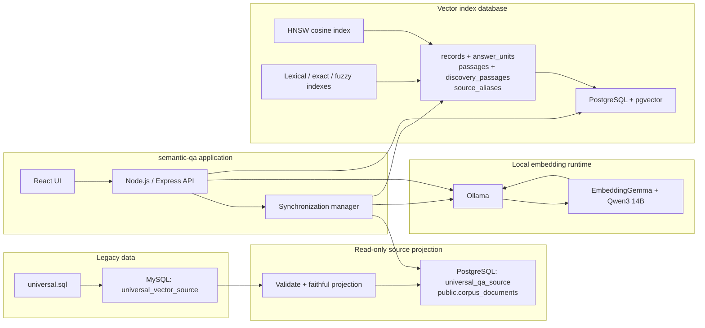
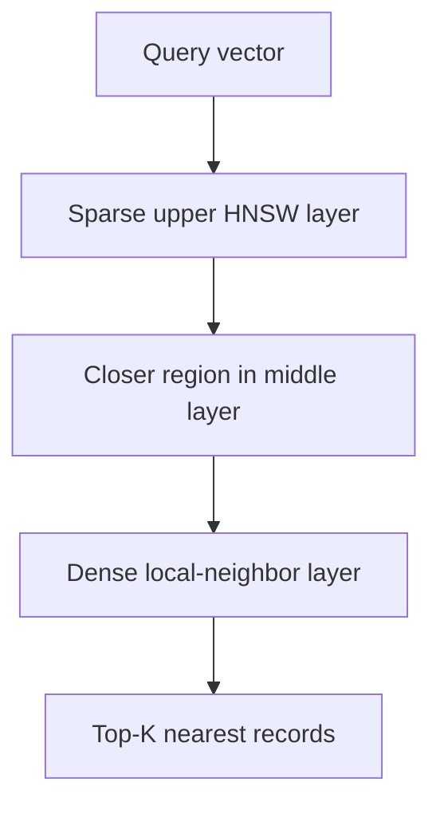
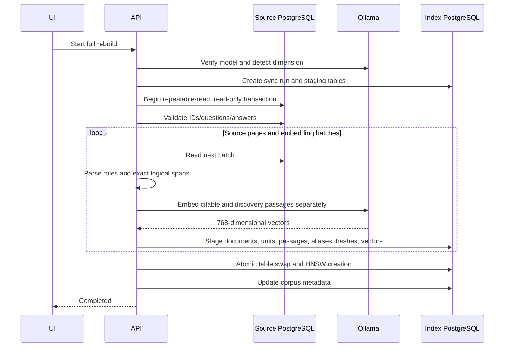
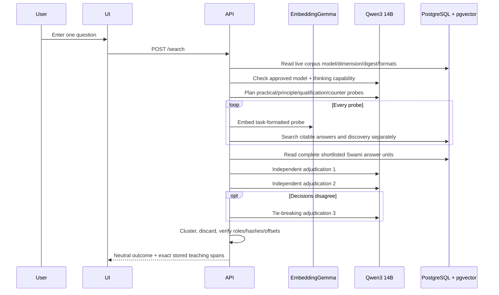

# Search Engine: Technical Architecture and Internal Working

This guide explains Search Engine (internal compatibility ID: `semantic-qa`) for developers who are new to PostgreSQL, pgvector, Ollama, embeddings, and semantic search. It describes the implementation that is running in this workspace, including the imported `tblQA` and `tblDiscourse` corpus.

## 1. The Short Version

The tool retrieves teachings that already exist in the database. It never asks a model to author Swami's displayed words. Qwen can plan probes, classify complete answer units, reject evidence, and assign neutral cluster labels; deterministic server code alone inserts exact stored source spans.

It works in two phases:

1. **Offline indexing:** MySQL is projected into one PostgreSQL row per original document with immutable raw content and faithful display text. Explicit speaker boundaries become complete answer units. Swami units produce citable logical passages; titles and devotee questions produce separate non-citable discovery passages.
2. **Online search:** focused queries search both channels. Shortlisted sources are reconstructed as complete Swami replies/teachings, independently adjudicated by reasoning-capable Qwen, clustered, and verified. The UI receives only exact stored teaching spans plus neutral labels/status.

The most important distinction is:

> The corpus is indexed, not used to train the model.

EmbeddingGemma is already trained. This application does not fine-tune it, update its weights, or teach it facts from this database.

## 2. Current Deployment

| Component | Current value |
| --- | --- |
| Web application | React UI with a Node.js/Express API |
| Standalone UI/API | `http://localhost:8790` |
| Ollama | `http://127.0.0.1:11434` |
| Embedding model | `embeddinggemma` |
| Deep Search model | `qwen3:14b-q8_0` by default; explicit Q4 optional |
| Deep Search context | 32K, `think: true`, one active generation |
| Vector dimension | 768 floating-point values |
| Source PostgreSQL | `127.0.0.1:5433/universal_qa_source` |
| Index PostgreSQL | `127.0.0.1:5433/universal_qa_index` |
| Vector extension | pgvector 0.8.5 |
| Original source documents | 6,010 |
| Previous v4 compatibility chunks | 19,777 |
| Previous v4 answer passages | 186,982 |
| Original active records | 419 Q&As and 5,591 discourses |
| Languages in the imported corpus | English, Malayalam, and Telugu |
| Universal-corpus match threshold | 0.49 |

EmbeddingGemma produces 768-dimensional retrieval vectors in the current installation. The corpus row stores the immutable model digest and format so replacement weights cannot silently share an incompatible vector space.

## 3. System Architecture



### Why are there two PostgreSQL databases?

The source database and index database have different responsibilities:

- `universal_qa_source` is the normalized, readable corpus. The application uses a read-only account for synchronization.
- `universal_qa_index` is owned by the tool. It stores exact synchronized text snapshots, metadata, embeddings, synchronization history, staging tables, and the HNSW index.

This separation prevents the retrieval tool from writing into the source corpus and allows a failed rebuild to leave the existing live index intact.

## 4. Data Preparation from MySQL

The legacy dump is first imported into MySQL as `universal_vector_source`. The application does not search MySQL directly. The importer at `scripts/importUniversalQa.js` produces a stable PostgreSQL projection.

### `tblQA` mapping

| MySQL field | Search meaning |
| --- | --- |
| `qaId` | Original source identity |
| `title` | Stored question |
| `answerBySwami` | Stored answer |
| `briefQuestion` or `questionBk` | Additional source context retained for inspection; not used in passage acceptance |
| `masterLanguage` | Language metadata |
| `masterId`, `recordDate` | Source metadata |

### `tblDiscourse` mapping

| MySQL field | Search meaning |
| --- | --- |
| `dcId` | Original source identity |
| `title` | Stored question/title |
| `textDC` | Stored answer/document text |
| `summary` | Additional source context retained for inspection; not used in passage acceptance |
| `masterLanguage` | Language metadata |
| `masterId`, `recordDate` | Source metadata |

`tblDiscourse` may contain several explicit asked/replied pairs or one unmarked teaching. The role parser recognizes English, Malayalam, and Telugu ask/reply and speaker labels. Explicit transitions create separate `devotee_question` and `swami_reply` units. Without an explicit transition, the body is Swami teaching even when its title is written as a question. Rhetorical questions stay inside the current Swami unit. A speaker-marked document whose boundaries cannot be resolved is excluded from citations and reported for review.

### Cleanup

The importer:

- includes active records only;
- validates empty fields and duplicate stable identities;
- preserves the original answer/document field byte-for-byte as `raw_content` and stores its SHA-256 hash;
- creates `display_text` only through deterministic HTML rendering, entity decoding, encoding repair, and layout cleanup;
- preserves Unicode wording and stores a separate display hash;
- never performs spelling, grammar, translation, summarization, or wording edits;
- defaults missing authors to `Swami`;
- stores the role-parse report and legacy aliases.

“Verbatim teaching” means an exact slice of `display_text`. `raw_content` is retained independently so the projection can always be audited back to the unchanged MySQL source field.

### Logical units and retrieval windows

The source projection is not chunked: it has exactly one row per original Q&A or discourse. The index parser records exact document offsets for every role unit. Citable passages align to complete paragraphs, stanzas, list items, or complete sentences. Oversized logical material may create overlapping embedding windows, but every citation expands back to the complete original logical span.

The previous 19,777 v4 chunk IDs remain only as aliases during migration. They resolve to the v5 document and, when unambiguous, its answer unit so existing citations and stored GPT conversations keep working.

## 5. What Ollama Does

Ollama is the local process that loads and runs the embedding model. The Node.js application sends HTTP requests to:

```text
POST http://127.0.0.1:11434/api/embed
```

The request is conceptually:

```json
{
  "model": "embeddinggemma",
  "input": ["text one", "text two"],
  "truncate": false
}
```

Ollama returns one numeric array for every input string.

Ollama is not a database and does not remember the corpus. It only performs model inference:

```text
text -> embedding model -> vector
```

The vectors are stored by PostgreSQL, not by Ollama.

The application restricts Ollama URLs to loopback hosts (`127.0.0.1`, `localhost`, or `::1`). This avoids accidentally sending corpus text to a remote embedding service.

## 6. What an Embedding Is

An embedding is a numeric representation of meaning. For the installed model, every text becomes an array of 768 numbers:

```text
[0.018, -0.042, 0.007, ... 765 more values]
```

The individual numbers do not have human-readable labels. Their usefulness comes from geometry:

- texts with related meaning tend to point in similar directions;
- unrelated texts tend to point in different directions;
- the same vector size is produced for a short question and a long chunk.

During indexing with EmbeddingGemma, the tool embeds each answer passage without the stored question/title:

```text
title:  | text: <bounded answer passage>
```

During search, it embeds:

```text
task: question answering | query: <new user question>
```

The index stores embedding- and retrieval-format versions alongside the model and dimension. Search is rejected with a full-rebuild instruction when either stored format is older than the running application. An incremental sync is also rejected when the format changes, so vectors created from different document inputs can never be mixed.

### The same model must be used on both sides

Vectors made by different models do not share a reliable coordinate system. Even two models that both return 768 numbers can assign different meanings to those coordinates.

For that reason, the index stores:

- embedding model name;
- immutable model digest reported by Ollama;
- embedding dimension;
- Ollama URL used for the corpus.

If the model tag resolves to different weights—even with the same name and dimension—or if the dimension or embedding format changes, the tool requires a full rebuild before search is allowed.

## 7. Training vs. Indexing

These terms are often confused.

### Model training

Training changes the neural network’s internal weights. It normally needs a training dataset, loss function, optimizer, significant compute, and an evaluation process.

This application performs **no training and no fine-tuning**.

### Embedding inference

Inference runs the already-trained model. It converts each text into a vector but does not modify the model.

This is what Ollama does here.

### Vector indexing

Indexing stores the vectors and builds a data structure that makes nearest-neighbor lookup fast.

This is what PostgreSQL and pgvector do here.

Adding records to the vector database does not teach EmbeddingGemma new facts. The facts remain in PostgreSQL text fields; the vector is only a retrieval key pointing toward that stored text.

## 8. PostgreSQL and pgvector Storage

The index database owns a `semantic_qa` schema.

### `semantic_qa.corpus`

One row describes the live corpus:

- source field mapping;
- embedding model;
- embedding dimension;
- Ollama URL;
- live record count;
- last synchronization time.

### `semantic_qa.records`

Each original source document stores:

| Column | Purpose |
| --- | --- |
| `source_id` | Stable original document ID |
| `question` | Exact synchronized question/title |
| `answer` | Faithful complete `display_text` |
| `metadata` | Raw/display hashes, source provenance, language, role report, aliases |
| `source_group` | Original Q&A/discourse identity |
| `source_order` | Optional deterministic source ordering |
| `content_hash` | SHA-256 change detector |
| `embedding` | Valid placeholder vector; v4 never searches this record-level field |
| `updated_at` | Index update time |

### `semantic_qa.answer_units`

One row represents one complete citable Swami reply or unmarked teaching section. It stores author, unit kind, associated devotee question, language, exact document offsets, exact text, completeness, and SHA-256 hash.

### `semantic_qa.passages`

Citable retrieval windows are derived only from Swami answer units. Every row stores retrieval-window text plus the complete logical citation text, both offset ranges, role/kind, context and story completeness, and an embedding. Database constraints and final server checks require the citation to equal the corresponding `records.answer` slice.

### `semantic_qa.discovery_passages`

Titles, devotee questions, source context, headings, and other non-citable context live here. Dense and lexical matches can nominate their source; this table can never supply displayed evidence.

### `semantic_qa.source_aliases`

Legacy v4 chunk/citation IDs resolve to canonical v5 documents and optional answer units. Search Engine and GPT use this table independently.

### `semantic_qa.sync_runs`

This table preserves recent synchronization outcomes and counters. Live SSE job listeners are held in Node.js memory, so a server restart ends live progress streaming but does not remove persisted completed-run history.

### Staging tables

Each synchronization run creates tool-owned unlogged tables:

- a staging records table for changed source snapshots;
- staging tables for answer units, citable passages, discovery passages, and aliases;
- a “seen IDs” table containing the complete current source identity set.

They are temporary working structures used to protect the live index.

## 9. Cosine Similarity

Cosine similarity measures the angle between two vectors rather than their absolute length.

For vectors `A` and `B`:

```text
cosine_similarity(A, B) = dot(A, B) / (length(A) * length(B))
```

Interpretation:

- `1.0`: same direction;
- `0.0`: geometrically unrelated/orthogonal;
- `-1.0`: opposite direction.

Real embedding scores are model- and corpus-dependent. A score is not a probability and `0.70` does not mean “70% correct.”

pgvector’s `<=>` operator returns **cosine distance**:

```text
cosine_distance = 1 - cosine_similarity
```

The search SQL therefore calculates similarity as:

```sql
1 - (embedding <=> $query_vector) AS similarity
```

and sorts nearest first:

```sql
ORDER BY embedding <=> $query_vector
LIMIT $top_k
```

The universal corpus uses a clear-match threshold of `0.49`. The smaller sample/default configuration uses `0.60`. Retrieval v4 applies it to passage relevance: answer-passage cosine plus only small specificity and independent-support bonuses. It must be calibrated with representative questions after any model, passage, or ranking change.

If the best result is below the threshold, the application returns exactly:

```text
I could not find a clear answer in the existing data.
```

It still returns the closest records so the user can inspect them, but the UI keeps those below-threshold neighbors in a collapsed, inspection-only panel. Only the single `acceptedMatch` can be presented as the best answer.

## 10. What HNSW Is

HNSW means **Hierarchical Navigable Small World**. It is an approximate nearest-neighbor index.

Without a vector index, PostgreSQL can calculate the cosine distance against every row. That is exact, but the work grows linearly with the number of records:

```text
query vector -> compare with record 1, record 2, ... record N
```

HNSW instead creates a graph:

- every vector is a graph node;
- nearby vectors are connected as neighbors;
- upper graph layers contain fewer, longer-range navigation links;
- lower layers contain denser local links.

At search time, PostgreSQL starts in a sparse upper layer, moves toward promising regions, descends through the hierarchy, and explores local neighbors near the query.



The application creates:

```sql
CREATE INDEX semantic_qa_records_embedding_hnsw
ON semantic_qa.records
USING hnsw (embedding vector_cosine_ops);
```

`vector_cosine_ops` tells pgvector that this index is intended for cosine-distance queries.

### HNSW trade-offs

Advantages:

- much faster nearest-neighbor lookup as the corpus grows;
- good recall in practice;
- no training phase for the index;
- supports insertion and querying in PostgreSQL.

Costs:

- index creation takes time;
- the graph consumes additional disk and memory;
- results are approximate rather than a guaranteed exhaustive comparison;
- build/query quality and speed can be tuned with HNSW parameters. Retrieval v3 raises `hnsw.ef_search` to match its bounded oversampled pool and enables strict iterative scanning on pgvector 0.8 or newer.

At the current 19,777-record scale, exact scanning would still be possible, but HNSW provides a better path as the corpus grows and keeps vector retrieval inside PostgreSQL.

## 11. Full Rebuild Internals



Detailed behavior:

1. Ollama is tested and the vector dimension is detected dynamically.
2. The source is opened in a repeatable-read, read-only transaction. All pages see one consistent database snapshot.
3. Preflight rejects null/duplicate IDs and empty questions or answers.
4. Source records are read in pages of 25–1,000 rows.
5. Embedding requests contain batches of 1–64 texts.
6. Every exact unit and passage is checked against its `display_text` offsets before embedding or staging.
7. Every vector and exact snapshot is written into versioned unlogged staging tables. Ambiguous speaker documents remain searchable as context but have no citable rows.
8. Embedding failures use bounded retries and identify offending source IDs without altering the live index.
9. Only after all source documents succeed does one transaction activate the v5 tables and update corpus metadata. A v4 live set is renamed to rollback tables during first promotion.

Cancellation, an Ollama error, a database error, or oversized input drops staging and leaves the previous live index searchable.

## 12. Incremental Synchronization

Incremental synchronization still scans the complete source so it can detect deletions. It avoids re-embedding unchanged records.

For every source document, the tool computes a SHA-256 hash over:

- source ID;
- question;
- answer;
- selected metadata;
- source group;
- source order.

The algorithm is:

```text
scan every source ID
    compute content hash
    compare it with live index hash
    if new or changed -> rebuild every role unit, citable passage, discovery passage, and alias
    if unchanged -> do not call Ollama

after successful complete scan
    upsert staged new/changed records
    delete live records not present in the seen-ID table
    commit once
```

Unchanged documents retain all existing embeddings. A changed discourse is rebuilt as a whole so a speaker transition cannot be separated from the text it governs. Deletions and replacements commit only after the complete source scan succeeds.

## 13. Online Search Internals



Step by step:

1. The API reads the model name, immutable digest, dimension, and format versions recorded with the live corpus.
2. It rejects stale formats or a configured Ollama model whose current digest differs from the indexed digest.
3. Verbatim Selection uses the initial retrieval and deterministic exact passage selection without a generation call.
4. Deep Search rejects any model except the approved Qwen3 14B Q8/Q4 tags and requires Ollama's `thinking` capability. It never falls back silently.
5. Qwen preserves the question's meaning and produces focused probes. Every probe searches answer and discovery channels independently using dense, lexical, exact-phrase, and fuzzy signals.
6. Discovery passages may add a source to the shortlist but are never transferred into evidence.
7. Every shortlisted complete Swami reply or teaching section is reconstructed and read. The model does not adjudicate 720-character fragments.
8. Two independent passes classify each unit as direct answer, governing principle, qualification, illustration, counter-teaching, or irrelevant. A third pass runs only for disagreements.
9. Personal experiences and success anecdotes are rejected unless the user explicitly requests examples. Stories require their consequence and Swami's explicit lesson.
10. Accepted units are grouped into distinct teaching clusters. Evidence can still be discarded; no preservation rule makes a mistaken candidate mandatory.
11. Final server code checks author, kind, context/story completeness, unit hash, passage hash, document bounds, and exact `display_text` equality.
12. The result is `direct`, `related_teachings`, or `insufficient`. Up to two primary exact passages are shown per cluster; extras remain expandable evidence.

Each question is independent. The tool has no conversational memory. Qwen's thinking trace is discarded and never stored or exposed. Progress reports the actual operation and elapsed time with no speculative ETA.

## 14. Multilingual Handling

Multilingual support comes from several layers working together:

1. The MySQL import uses `utf8mb4`.
2. Node.js strings and PostgreSQL `text` preserve Unicode.
3. Legacy HTML entities are decoded before indexing.
4. Malayalam and Telugu use smaller chunks to remain within the model context.
5. The same EmbeddingGemma model embeds all languages into one vector space.
6. `masterLanguage` is preserved as result metadata.

There is no automatic translation. The stored answer remains in its original language.

The embedding model can represent multiple languages in one shared numeric space, so semantically related text may be retrievable across languages. However, cross-language retrieval quality depends on the model and should be tested with representative real questions. Encoding correctness does not automatically guarantee identical semantic quality in every language.

If language-specific quality becomes insufficient, possible future approaches include:

- calibrating thresholds per language;
- adding language filters;
- selecting a stronger multilingual embedding model and fully rebuilding;
- maintaining separate language-specific corpora;
- adding an explicitly reviewed translation layer before embedding.

## 15. Ranking, Grouping, and Thresholds

These are four separate concepts:

- **Similarity** is the numeric cosine score from pgvector.
- **Lexical score** is PostgreSQL's full-text rank for answer-passage recall; it does not admit a result.
- **Passage meaning** is cosine similarity between the question and one independently indexed answer passage.
- **Relevance score** is passage meaning plus a small independent-semantic-support bonus. Lexical rank, word overlap, stored questions, and titles have zero acceptance weight.
- **Relevance rank** is the final position after passage pooling and explicit document-chunk deduplication.

For example, passage 4 of chunk 9 may directly answer the question even when the chunk's stored title describes another subject. That passage can win because title similarity has no acceptance weight. A `source_group` is treated as one document only when explicit `chunk_count > 1` metadata confirms that relationship; categories remain separate records.

The threshold is a product decision, not a mathematical truth. It should be calibrated separately when the model, chunking strategy, corpus, or languages change.

The executable regression set in `eval/relevance-cases.json` records reviewed question-to-source-group and question-to-answer-record judgments plus unanswerable negatives. `npm run eval:universal` measures Recall@5, top-one accuracy, mean reciprocal rank, answer-record rank, and false accepts against the live API. `npm run eval:corpus` also replays every structured-Q&A detailed source question and gates broad top-one/top-five recall plus confident wrong answers. Together they catch wrong-sibling, candidate-recall, and overconfidence regressions that database health checks and embedding-dimension tests cannot detect.

## 16. Safety and Data Integrity

### Database safety

- The source PostgreSQL account is read-only.
- The index database is separate and tool-owned.
- UI users cannot submit raw SQL.
- Table and column names must match a strict PostgreSQL identifier pattern.
- Data values are parameterized.
- Source synchronization runs against a consistent repeatable-read snapshot.
- Full and incremental commits are transactional.

### Secret handling

- Passwords and complete connection strings remain in browser memory.
- They are stripped from persisted local storage.
- Error messages redact PostgreSQL URL passwords.
- Secrets are removed from in-memory sync configuration after a job finishes.

### Retrieval grounding

- Every displayed teaching equals an exact synchronized `display_text` slice.
- Citable rows can only be derived from `swami_reply` or `swami_teaching` units.
- Titles, devotee questions, translator notes, and ambiguous speakers are discovery context only.
- A weak match produces the exact no-match message and closest source records.
- Verbatim Selection performs no generation.
- Deep Search uses complete answer units for judgment and exact logical passages for display.
- Independent adjudications can reject evidence at every stage and abstain.
- Models never copy, compose, correct, summarize, translate, or join teaching text.
- Raw/display hashes and offsets are verified before any evidence is returned.

## 17. API and UI Responsibilities

### UI screens

- **Setup:** diagnostics and local presets.
- **Settings:** source/index connections, embedding model, approved Deep Search model, field mapping, result count, and threshold.
- **Index:** initialization, status, full rebuild, incremental sync, progress, cancellation, and errors.
- **Search:** independent semantic/text queries, exact teaching clusters, and plain-text source cards.

### Main API operations

| Operation | Purpose |
| --- | --- |
| `/diagnostics` | Test API, source PostgreSQL, index PostgreSQL, pgvector, and Ollama |
| `/source/catalog` | Discover safe schemas/tables/columns |
| `/index/initialize` | Create extension/schema/tables/index metadata |
| `/index/status` | Read live corpus and recent synchronization status |
| `/sync` | Start full or incremental synchronization |
| `/sync/:jobId/events` | Stream progress using server-sent events |
| `/sync/:jobId/cancel` | Request safe cancellation |
| `/search` | Retrieve passages and optionally run Verbatim Selection or six-stage Deep Search |

Standalone routes use `/api`; the shared toolkit host uses `/api/tools/semantic-qa`.

## 18. Code Map for New Developers

| File | Responsibility |
| --- | --- |
| `src/server.js` | Standalone Express server and static UI hosting |
| `src/registerRoutes.js` | Request schemas and public API routes |
| `src/ollama.js` | Model identity, embeddings, thinking-capability enforcement, probe planning, and adjudication |
| `src/corpusStructure.js` | Multilingual speaker parsing, answer units, exact citation spans, hashes, and story completeness |
| `src/core.js` | Model-aware formats, hashing, passage pooling/scoring, document deduplication, threshold response |
| `src/semanticSummary.js` | Fast deterministic verbatim teaching selection |
| `src/deepSummaryManager.js` | Six-stage Deep Search, bounded retries/deadlines, clustering, exact final verification |
| `src/database.js` | v5 tables, atomic staging/promotion, aliases, answer/discovery retrieval, exact slice checks |
| `src/syncManager.js` | Job lifecycle, batching, cancellation, SSE, full/incremental orchestration |
| `scripts/importUniversalQa.js` | Read-only validation and faithful one-document MySQL projection |
| `scripts/evaluateV5Promotion.js` | Mandatory live Q8 promotion replay and exactness gate |
| `scripts/evaluateRetrieval.js` | Live retrieval, answer-record, confidence, and false-accept regression runner |
| `scripts/evaluateCorpusQueries.js` | Broad live replay of structured-Q&A detailed source questions |
| `eval/relevance-cases.json` | Reviewed positive answer judgments and unanswerable negative cases |
| `src/ui/SemanticQaTool.jsx` | Setup, Search, Index, and Settings screens |
| `src/ui/settings.mjs` | Defaults, presets, and secret-safe persistence |

## 19. Common Operational Flows

### First index build

```text
Update MySQL source rows
-> run import:universal:check
-> review role/ambiguity/hash counts
-> run import:universal
-> load universal preset
-> run diagnostics
-> initialize index
-> full rebuild
-> run retrieval evaluations
-> run mandatory eval:promotion:v5 live Q8 replay
```

### Source data changed

```text
update MySQL source
-> run import:universal:check
-> run import:universal
-> incremental sync
-> review changed-document report
-> unchanged documents reuse their vectors
```

The first `passage-v4` to `answer-unit-v5` migration is a full rebuild. Incremental sync is used only after v5 has been activated; it intentionally rejects a v4 index instead of attempting a partial format migration.

### Embedding model changed

```text
pull/test new model
-> select it in Settings
-> full rebuild required
-> recalibrate thresholds
```

Changing only the model name is not enough. Every stored vector must be regenerated with the same new model.

## 20. Practical Mental Model

Think of the system as a semantic library:

- PostgreSQL source rows are the books.
- The import process preserves each book and identifies explicit speaker sections.
- EmbeddingGemma assigns each section a semantic coordinate.
- pgvector stores coordinates for citable Swami passages and separate discovery context.
- Qwen judges complete shortlisted replies but never writes the displayed teaching.
- deterministic code returns exact stored source spans.
- HNSW is a map of nearby semantic neighborhoods.
- A user question receives its own coordinate.
- Search follows the HNSW map to nearby sections.
- The application hands back the original stored sections; it does not write a new book.

That is the entire retrieval contract: use AI for semantic coordinates, use PostgreSQL for durable truth, and return source text rather than generated interpretation.
